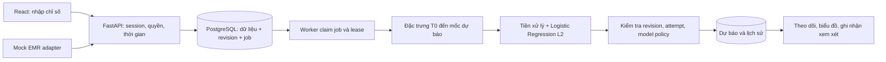

# Kiến trúc Sepsis Signal

## Thành phần

| Vùng | Trách nhiệm |
| --- | --- |
| `frontend/src/app/` | React Router, điều hướng và provider gốc |
| `frontend/src/features/` | Auth, theo dõi/cảnh báo, hồ sơ, replay, đánh giá |
| `frontend/src/components/` | Khung ứng dụng, biểu đồ, bảng và thành phần dùng chung |
| `frontend/src/lib/` | Hợp đồng lâm sàng, reader tại thời điểm, state và API client |
| `backend/app/main.py` | HTTP API, giới hạn request, xác thực và phục vụ Vite build |
| `backend/app/db/` | SQLAlchemy, schema v3, transaction và hàng đợi PostgreSQL |
| `backend/app/emr.py` | Canonical EMR: đơn vị, thời điểm nhận, idempotency và correction |
| `backend/worker.py` | Tiến trình chấm riêng, retry và phục hồi job hết lease |
| `src/` | Lõi đặc trưng từ T0, tiền xử lý và Logistic Regression L2 |
| `artifacts/` | Mô hình và metadata bất biến theo bản triển khai |
| `app/` | Streamlit riêng, giữ để đối chiếu; không phục vụ web |

## Luồng xử lý

HTTP lưu dữ liệu không chờ mô hình chạy. `work_jobs` là hàng đợi bền vững trên PostgreSQL; ghi dữ liệu và job cùng transaction nên không có khoảng mất job do ghi DB thành công nhưng gửi broker thất bại. Worker khóa encounter và dùng `SKIP LOCKED`; mã attempt loại kết quả từ worker hết lease. Tối đa 3 lần thử, backoff, sau đó người dùng có thể yêu cầu chấm lại dữ liệu đã lưu. Chưa cần Redis/Celery trong quy mô hiện tại.

Khi sửa chỉ số, các kết quả hiện hành bị vô hiệu hóa ngay, revision tăng và tất cả giờ đã chấm được tính lại. Kết quả chỉ giữ ID cũ khi đặc trưng, model, ngưỡng, score, khoa và số đặc trưng không đổi; khi mất điều kiện chấm thì không còn kết quả hiện hành. Lịch sử xem xét không bị xóa. Job pin checksum model/metadata và schema đặc trưng. Mô hình không được thay nóng trong tiến trình: build và khởi động lại API/worker cùng một phiên bản.

T0 lưu được sinh hiệu/xét nghiệm, chấm từ T0+1 đến T0+36. Cửa sổ quan sát là [T0, thời điểm dự báo], horizon là 6 giờ tương lai. Kết quả xét nghiệm chỉ được dùng sau thời điểm trả. Với EMR, thời điểm có sẵn hiệu lực còn phải không sớm hơn lúc server thực nhận; không hồi tố dữ liệu đến muộn vào các mốc trước đó.

## Màn hình

- `/dashboard`: hàng đợi hiện tại và lịch sử; không lặp registry.
- `/patients`, `/patients/new`, `/patients/:id?hour=N`: tìm, tạo, nhập và xem ca.
- `/sample-cases`, `/model-monitoring`: replay và nghiên cứu.
- `/alerts`: URL tương thích chuyển về dashboard và giữ bộ lọc.

React Router quản lý cả thay đổi query; không dùng `history.replaceState` trực tiếp vì không cập nhật state bộ lọc. Desktop giữ vùng chính trong viewport; nội dung dài cuộn trong panel. Mobile cuộn tự nhiên để giữ chữ đọc được.

## Giới hạn

Snapshot vẫn tải toàn bộ dữ liệu hiện hành và lịch sử; xem [số đo](migration/snapshot-benchmark.json). Chưa có API phân trang phía server, phân quyền theo khoa hay SSO. Adapter hiện là hợp đồng mô phỏng; mapping item ID và hợp đồng EMR bệnh viện cần được xác nhận riêng. SQLite chỉ còn cho hồi quy, di chuyển dữ liệu cũ và tùy chọn chạy nhỏ.
